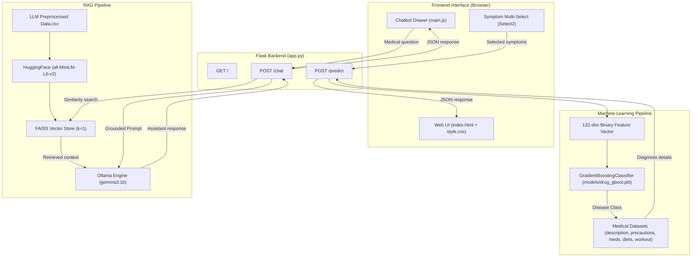

# Drug Recommendation System with ML Disease Prediction and RAG Chatbot

An AI-powered healthcare assistant application that combines **Supervised Machine Learning (Gradient Boosting)** for symptom-based disease diagnosis with a **Retrieval-Augmented Generation (RAG)** chatbot powered by **LangChain, FAISS, HuggingFace Embeddings, and Ollama (Gemma 3:1B)**.

---

## 📌 Project Overview

This project provides an interactive clinical decision-support and medical inquiry interface consisting of two synchronized modules:

1. **ML Disease Prediction Module**:
   - Accepts multi-select patient symptoms from a curated list of **132 clinical symptoms**.
   - Feeds a 132-dimensional binary vector to a trained **Gradient Boosting Classifier**.
   - Predicts the underlying condition across **41 disease classes**.
   - Instantly retrieves comprehensive post-diagnosis metadata: disease overview, four actionable precautions, prescription/OTC medications, dietary advice, and lifestyle/workout plans.

2. **RAG Medical Chatbot Module**:
   - Indexes preprocessed disease information (`LLM Preprocessed Data.csv`) using dense vector representations generated by `sentence-transformers/all-MiniLM-L6-v2`.
   - Uses an in-memory **FAISS** vector store to retrieve top-matching medical documents for user queries.
   - Grounded inference is performed via **LangChain** and a locally hosted **Ollama** large language model (`gemma3:1b`).
   - Strictly constrained by a medical prompt to prevent hallucination, reject fabrication of ungrounded drug dosages, and reinforce that responses are educational.

---

## 🏗️ System Architecture



---

## 🚀 Key Features

- **Multi-Symptom Disease Diagnosis**: Fast inference across 41 common and rare conditions using an ensemble Gradient Boosting model.
- **Context-Grounded Medical Q&A**: RAG architecture retrieves verified medical data before generating answers, avoiding LLM hallucinations.
- **Privacy & Local Execution**: Runs locally using Ollama (`gemma3:1b`) and HuggingFace Sentence Transformers—no sensitive patient queries sent to external cloud APIs.
- **Modern Responsive UI**: Dark glassmorphic interface with real-time dynamic search, loading indicators, and an interactive drawer chatbot.
- **Robust Error Handling**: Frontend input validation, safe DOM text rendering against XSS, and graceful backend degradation when external services are unavailable.

---

## 🛠️ Technology Stack

| Layer | Technologies |
| :--- | :--- |
| **Backend Framework** | Flask, Flask-CORS |
| **Machine Learning** | Scikit-learn, NumPy, Pandas |
| **RAG & Vector Search** | LangChain, LangChain-Community, LangChain-Ollama, FAISS (`faiss-cpu`) |
| **Embeddings & LLM** | HuggingFace Sentence Transformers (`all-MiniLM-L6-v2`), Ollama (`gemma3:1b`) |
| **Frontend** | HTML5, CSS3, JavaScript (ES6+), jQuery, Select2, FontAwesome |

---

## 📂 Repository Structure

```text
drug prediction/
│
├── app.py                             # Flask application connecting ML & RAG endpoints
├── prepare_data.py                    # Dataset consolidation script for RAG CSV creation
├── requirements.txt                   # Project dependencies
├── README.md                          # Comprehensive project documentation
├── .gitignore                         # Git exclusion rules
├── LLM Preprocessed Data.csv          # Knowledge base for RAG (41 disease summaries)
│
├── dataset/                           # Curated medical reference datasets
│   ├── description.csv                # Disease descriptions
│   ├── diets.csv                      # Dietary recommendations
│   ├── Drug_Recommendation_Data.csv   # Training dataset (132 symptoms + prognosis)
│   ├── medications.csv                # Prescribed and OTC medications
│   ├── precautions_df.csv             # 4 precautions per condition
│   ├── symtoms_df.csv                 # Symptom mapping dataset
│   └── workout_df.csv                 # Workout and lifestyle recommendations
│
├── models/
│   └── drug_gboot.pkl                 # Trained Gradient Boosting Classifier (132 features, 41 classes)
│
├── notebooks/
│   ├── Drug Recommendation System - ML.ipynb  # ML training and evaluation notebook
│   └── LLM Drug Recommendation.ipynb          # RAG pipeline experimentation notebook
│
├── templates/
│   └── index.html                     # Web application UI template
│
└── static/
    ├── css/
    │   └── style.css                  # Dark-mode glassmorphic styling
    └── js/
        └── main.js                    # AJAX communication, Select2 initialization, chat handling
```

---

## ⚙️ Installation & Setup

### Prerequisites
- **Python 3.9 – 3.13** installed on your system.
- **Ollama** installed ([https://ollama.com](https://ollama.com)).
- **Git** installed ([https://git-scm.com](https://git-scm.com)).

---

### Step 1: Clone the Repository
```bash
git clone https://github.com/YOUR_USERNAME/drug-recommendation-system.git
cd drug-recommendation-system
```

### Step 2: Set Up Virtual Environment
```bash
# Windows
python -m venv venv
venv\Scripts\activate

# Linux / macOS
python3 -m venv venv
source venv/bin/activate
```

### Step 3: Install Python Dependencies
```bash
pip install -r requirements.txt
```

### Step 4: Pull and Start the Ollama LLM
Ensure the Ollama service is running on your machine, then pull the `gemma3:1b` model:
```bash
ollama pull gemma3:1b
```

*(Optional: Verify Ollama is responding by running `ollama run gemma3:1b "Hello"` in a terminal.)*

---

## 🏃 Running the Application

1. Make sure your virtual environment is active and Ollama is running.
2. Start the Flask server:
```bash
python app.py
```
3. Open your browser and navigate to:
```
http://127.0.0.1:5000
```

---

## 📡 API Reference

### 1. Symptom-Based Disease Prediction
- **Endpoint**: `/predict`
- **Method**: `POST`
- **Body** (`application/x-www-form-urlencoded`):
  ```
  symptoms=itching,skin_rash,nodal_skin_eruptions
  ```
- **Response** (`application/json`):
  ```json
  {
    "disease": "Fungal infection",
    "description": "Fungal infection is a common skin condition caused by fungi...",
    "precautions": [
      "bath twice",
      "use dettol or neem in bathing water",
      "keep area dry",
      "use clean cloths"
    ],
    "medications": [
      "Antifungal Cream",
      "Fluconazole",
      "Terbinafine",
      "Clotrimazole",
      "Ketoconazole"
    ],
    "diets": [
      "Antifungal Diet",
      "Probiotics",
      "Garlic",
      "Coconut oil",
      "Turmeric"
    ],
    "workout": [
      "Avoid heavy workouts that cause excessive sweating",
      "Wear loose, moisture-wicking clothing during light activity",
      "Shower immediately after any physical exercise"
    ]
  }
  ```

### 2. Medical RAG Chatbot
- **Endpoint**: `/chat`
- **Method**: `POST`
- **Body** (`application/json`):
  ```json
  {
    "message": "What dietary precautions should I take for Fungal infection?"
  }
  ```
- **Response** (`application/json`):
  ```json
  {
    "response": "For a fungal infection, dietary recommendations include following an antifungal diet, consuming probiotics, garlic, coconut oil, and turmeric. Please consult a qualified medical professional for personalized advice."
  }
  ```

---

## ⚠️ Medical Disclaimer

> **IMPORTANT**: This application is developed strictly for **academic, educational, and research demonstration purposes**. It is not clinically validated, nor is it a medical diagnostic device. Predictions, medication suggestions, and chatbot responses must never be used as a substitute for professional clinical diagnosis, consultation, or treatment by a licensed physician or healthcare specialist.
