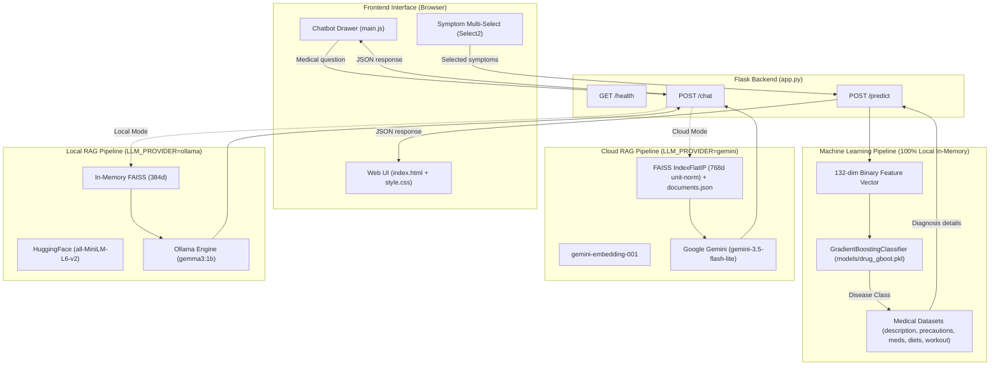

# Drug Recommendation System with ML Disease Prediction and RAG Chatbot

## 🚀 Live Demo

**Try the deployed application here:**

[Drug Recommendation System – Live Application](https://drug-recommendation-system-klxs.onrender.com/)

**Deployment Platform:** Render

An AI-powered healthcare assistant application that combines **Supervised Machine Learning (Gradient Boosting)** for symptom-based disease diagnosis with a **Dual-Mode Retrieval-Augmented Generation (RAG)** chatbot powered by **LangChain, FAISS, Google Gemini (Cloud), and Ollama (Local)**.

---

## 📌 Project Overview

This project provides an interactive clinical decision-support and medical inquiry interface consisting of two synchronized modules:

1. **ML Disease Prediction Module**:
   - Accepts multi-select patient symptoms from a curated list of **132 clinical symptoms**.
   - Feeds a 132-dimensional binary vector to a trained **Gradient Boosting Classifier**.
   - Predicts the underlying condition across **41 disease classes**.
   - Instantly retrieves comprehensive post-diagnosis metadata: disease overview, four actionable precautions, prescription/OTC medications, dietary advice, and lifestyle/workout plans.
   - **Local Inference Benchmark**: Measured locally on a Windows test machine across 100 runs (Mean: 1.31 ms, Median P50: 1.18 ms, P95: 1.85 ms, P99: 2.64 ms). *(Note: This is a local CPU benchmark, not an assertion of Render cloud production latency, which is subject to container scheduling).*
   - Operates 100% locally in-memory on CPU with zero external network or API dependencies.

2. **Dual-Mode RAG Medical Chatbot Module**:
   - **Cloud Mode (`LLM_PROVIDER=gemini`)**: Uses precomputed FAISS embeddings (`gemini-embedding-001`, 768d unit-normalized) with a pure JSON metadata store (zero pickle deserialization) and Google's high-efficiency `gemini-3.5-flash-lite` model for low-latency cloud deployment on Render Free.
   - **Local Mode (`LLM_PROVIDER=ollama`)**: Uses in-memory FAISS with HuggingFace Sentence Transformers (`all-MiniLM-L6-v2`) and local Ollama (`gemma3:1b`) for complete offline execution without cloud API keys.
   - Strictly constrained by a medical prompt to prevent hallucination, reject fabrication of ungrounded drug dosages, and reinforce that responses are educational.

---

## 🏗️ System Architecture



---

## 🚀 Key Features

- **Multi-Symptom Disease Diagnosis**: Fast inference across 41 conditions using an ensemble Gradient Boosting model trained on 132 symptoms.
- **Dual-Mode RAG Architecture**: Switch seamlessly between local offline development (Ollama) and cloud deployment (Render + Gemini).
- **Pickle-Free Secure Vector Storage**: Cloud vector metadata is stored in pure UTF-8 JSON (`documents.json`), completely eliminating Python pickle deserialization vulnerabilities.
- **Disease-Aware Grounded Q&A**: Diagnosed diseases are validated against a 41-class whitelist; questions regarding a diagnosed condition are strictly grounded in that condition's profile.
- **Resilient Multi-State Health Endpoint**: `/health` accurately reports system states (`healthy`, `initialized_unverified`, `degraded`, `unhealthy`) without draining external API quotas.
- **Modern Responsive UI**: Dark glassmorphic interface with real-time dynamic search, loading indicators, and an interactive drawer chatbot.

---

## 🛠️ Technology Stack

| Layer | Technologies |
| :--- | :--- |
| **Backend Framework** | Flask 2.2.5, Werkzeug 2.3.8 |
| **Production WSGI** | Gunicorn 22.0.0 (Linux / Render) |
| **Machine Learning** | Scikit-learn 1.7.2, NumPy 1.26.4, Pandas 2.3.3 |
| **Vector Search** | FAISS (`faiss-cpu` 1.13.2) |
| **Cloud RAG Stack** | LangChain 1.2.9, `langchain-google-genai` 4.4.3, `google-genai` 3.0.0 |
| **Local RAG Stack** | `langchain-huggingface` 1.2.0, `sentence-transformers` 5.2.2, Ollama 0.6.1 (`gemma3:1b`) |
| **Frontend** | HTML5, CSS3, JavaScript (ES6+), jQuery, Select2, FontAwesome |

---

## 📂 Repository Structure

```text
drug prediction/
│
├── app.py                             # Flask application connecting ML & dual-mode RAG
├── prepare_data.py                    # Dataset consolidation script for RAG CSV creation
├── build_cloud_index.py               # Offline precomputation script for Gemini FAISS index
├── requirements.txt                   # Production cloud dependencies (Render deployment)
├── requirements-local.txt             # Local offline dependencies (Ollama + PyTorch)
├── Procfile                           # Gunicorn entrypoint for Render Linux container
├── .python-version                    # Pinned Python runtime (3.11.9)
├── .env.example                       # Environment variables configuration template
├── .gitignore                         # Git exclusion rules (safely tracking cloud vectorstore)
├── README.md                          # Comprehensive project documentation
│
├── dataset/                           # Medical datasets
│   ├── Drug_Recommendation_Data.csv
│   ├── description.csv
│   ├── precautions_df.csv
│   ├── medications.csv
│   ├── diets.csv
│   ├── workout_df.csv
│   └── symtoms_df.csv
│
├── models/
│   └── drug_gboot.pkl                 # Trained Gradient Boosting Classifier (SHA-256 verified)
│
├── vectorstore/
│   └── faiss_gemini/                  # Precomputed cloud vector store (Pure JSON + FAISS)
│       ├── index.faiss                # Binary FAISS IndexFlatIP (768 dimensions)
│       ├── documents.json             # Document texts and metadata (Pickle-free)
│       └── checksums.json             # SHA-256 verification hashes
│
├── templates/
│   └── index.html                     # Frontend user interface
│
└── static/
    ├── css/style.css                  # UI styling
    └── js/main.js                     # Frontend event handling & AJAX logic
```

---

## ⚙️ Environment Variables

Create a `.env` file in the root directory (refer to `.env.example`):

| Variable | Default | Purpose |
| :--- | :--- | :--- |
| `LLM_PROVIDER` | `ollama` | Provider selection: `gemini` for cloud, `ollama` for local |
| `GEMINI_API_KEY`| *(Optional)* | Google AI Studio API key (required when `LLM_PROVIDER=gemini`) |
| `GEMINI_MODEL` | `gemini-3.5-flash-lite` | Gemini model identifier |
| `PORT` | `5000` | Port for the web server (automatically configured on Render) |

---

## 💻 Local Development Setup

### Option A: Local Offline Development (Ollama)
1. Install local dependencies:
   ```bash
   pip install -r requirements-local.txt
   ```
2. Ensure Ollama is running with Gemma 3:1B:
   ```bash
   ollama pull gemma3:1b
   ollama serve
   ```
3. Run the application:
   ```bash
   python app.py
   ```
4. Open `http://127.0.0.1:5000` in your browser.

### Option B: Local Testing in Cloud Mode (Gemini)
1. Set environment variables:
   ```bash
   export LLM_PROVIDER=gemini
   export GEMINI_API_KEY=your_key_here
   ```
2. Build the cloud FAISS index (one-time offline precomputation):
   ```bash
   python build_cloud_index.py
   ```
3. Run the application:
   ```bash
   python app.py
   ```

---

## ☁️ Render Free-Tier Hosting Limitations & Realities

This project is architected to operate within Render's free tier allowances under the strict condition that **no payment method is attached**:

1. **Memory Ceiling**: Render Free allocates **512 MB RAM**. Our cloud architecture omits PyTorch and SentenceTransformers to maintain a measured local component baseline under 200 MB. *(Note: This baseline was measured locally on a Windows test machine; production RAM usage on Render Linux will vary based on Gunicorn worker processes, thread concurrency, and incoming traffic).*
2. **Inactivity Sleep (Spin-Down)**: The web service automatically spins down after **15 minutes without web traffic**. The first incoming request triggers a container wake-up (cold start) taking approximately **50 seconds to 1 minute**. Subsequent requests respond immediately.
3. **Monthly Free Instance Hours**: A free workspace includes **750 hours per month**. A single web service running continuously in a 31-day month consumes 744 hours (31 days * 24 hours = 744 hours).
4. **Outbound Bandwidth (5 GB/month)**: Free Hobby workspaces include **5 GB of monthly outbound bandwidth**, which encompasses both public HTTP responses served to browser clients and service-initiated outbound traffic (such as API calls to Google Gemini). Outbound bandwidth consumption depends directly on asset transfer sizes, request volume, and payload sizes.
5. **Build Pipeline Minutes**: Free workspaces include **500 build minutes per month**.
6. **Zero-Cost vs. Suspension**: As long as **no payment method is added**, Render cannot charge any fees. If monthly instance hours, build minutes, or outbound bandwidth limits are exceeded, Render **suspends the service** until the next calendar month reset. Adding a payment method enables pay-as-you-go overage billing; therefore, **never attach a credit card or payment method** if zero financial cost is strictly required.

---

## 📜 Datasets, Licensing & Attribution

### Project Code Licence
The original application code, scripts, and documentation developed specifically for this project are licensed under the **[Apache License 2.0](LICENSE)**. This licence applies solely to original project code to the extent that the project author holds copyright, and does not override or supersede the third-party dataset licences described below.

### Third-Party Datasets & Attribution
This project incorporates and builds upon data from two primary third-party sources:

1. **Medicine Recommendation System Dataset** (Curated by **Noor Saeed**):
   - **Source:** [Kaggle Dataset](https://www.kaggle.com/datasets/noorsaeed/medicine-recommendation-system-dataset)
   - **Reported Licence:** **Apache License 2.0**
   - **Constituent Files:** `description.csv`, `precautions_df.csv`, `medications.csv`, `diets.csv`, `workout_df.csv`, and `symtoms_df.csv`.
   - **Derived Compilation:** `LLM Preprocessed Data.csv` is a derived compilation created by `prepare_data.py` through canonical disease normalization and inner-joining of the five runtime tables.
   - **Derived Vector Artefacts:** If generated by `build_cloud_index.py`, cloud vector store artefacts (`vectorstore/faiss_gemini/documents.json` and `index.faiss`) represent derived representations whose redistribution remains subject to applicable Apache 2.0 attribution and notice conditions.

2. **Disease Prediction Using Machine Learning Dataset** (Curated by **Kaushil Shah / kaushil268**):
   - **Source:** [Kaggle Dataset](https://www.kaggle.com/datasets/kaushil268/disease-prediction-using-machine-learning)
   - **Reported Licences:** **Open Data Commons Open Database License (ODbL) v1.0** (database structure) and **DbCL v1.0** (contents).
   - **Constituent File:** `Drug_Recommendation_Data.csv` (local renamed copy of `Training.csv`).
   - **Trained Model Provenance:** The Gradient Boosting classifier (`models/drug_gboot.pkl`) was trained offline using this dataset. While models trained on databases are commonly considered "Produced Works" under ODbL Section 4.5, no unsupported definitive legal declaration is made; its formal legal classification has not been independently determined.
   - **ODbL Conditions:** Attribution is provided pursuant to ODbL § 4.3. Note that `LLM Preprocessed Data.csv` does not adapt or incorporate data from `Drug_Recommendation_Data.csv`, so ODbL Share-Alike (§ 4.4) does not attach to it.

> **Full Documentation**: For comprehensive dataset provenance, original source disclosures, licensing boundaries, and third-party notices, refer to **[`THIRD_PARTY_NOTICES.md`](THIRD_PARTY_NOTICES.md)**.

---

## ⚠️ Medical & Educational Disclaimer

> **IMPORTANT**: This application is developed strictly for **educational and research demonstration purposes**. It is **not** a clinically validated diagnostic device or prescription tool. Predictions, medication suggestions, and chatbot responses must never be used as a substitute for professional clinical diagnosis, consultation, or treatment by a licensed physician or healthcare specialist. Always consult a qualified healthcare professional regarding any medical condition.
